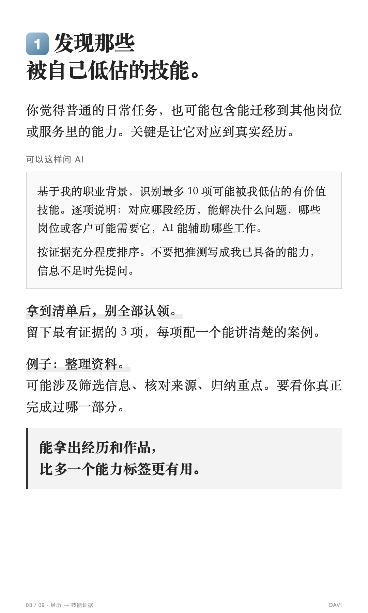

# 小红书成稿工坊

项目网站：[小红书成稿工坊 · GitHub Pages](https://ricardozdw-dotcom.github.io/xiaohongshu-content-studio/)。网站提供介绍、版式预览、安装指引及独立浏览器转写工具；不是自动生成整套小红书稿件的在线服务。

当前版本：**0.2.0**。新增 [浏览器声音转文字](https://ricardozdw-dotcom.github.io/xiaohongshu-content-studio/tools/browser-transcribe.html)：使用者可录制目标标签页音频，在浏览器本地识别并导出 TXT / SRT / JSON，不依赖原作者的电脑或 API Key。

`xiaohongshu-content-studio` 将链接或上传材料整理为文档，经内容确认后改写，再制作带文字的小红书图文。它是一个可安装的 Agent Skill，不是自动抓取所有视频或自动发布账号的服务。

## 三阶段流程

1. **内容整理**：读取链接的有效正文、视频口播和关键画面，输出原始内容整理文档，等待用户检查或要求改写。
2. **重新梳理**：观点类重建表达；教程保留前置条件、步骤、命令、参数与验收标准。输出改写文档，等待确认并要求做图。
3. **图文制作**：按白底宋体、黑色标题、灰色划线、蓝色编号和写实封面制作 1080×1800 PNG，附标题、正文、标签、可复制文本及 ZIP。

全局的“后续操作都允许”不替代内容确认。阶段记录绑定文档版本，修改后旧确认失效；模板测试预览不能打包成正式稿。

## 安装与调用

本仓库根目录就是 skill 目录。可以在支持技能安装的 Codex 环境中提出：

> 使用 skill-installer，从 https://github.com/ricardozdw-dotcom/xiaohongshu-content-studio 安装根目录的 skill，名字保持 xiaohongshu-content-studio。

也可以把完整目录放在宿主支持的个人技能目录。当前 Codex 文档列出用户目录 `~/.agents/skills`，仓库目录 `.agents/skills`；不同宿主请使用其实际技能位置。[官方技能说明](https://learn.chatgpt.com/docs/build-skills)

安装后可这样请求：

> 使用 $xiaohongshu-content-studio，先整理这个链接的内容，输出文档，等我确认后再改写和制作小红书图文。

## 能力与限制

- 链接读取、登录访问和图像生成由宿主提供。本包不自带登录凭据或付费 API。口播优先宿主已有能力，另自带可公开使用的浏览器录音转写页。
- 无完整字幕时先检查音频转写路径，不止步于网页章节摘要。包内浏览器工具需要桌面浏览器支持共享标签页音频、用户自行选择权限，以及首次联网下载模型。Safari、移动端和内置浏览器不保证支持。
- 自动识别结果待核对，不保证中文专业术语准确；新视频任务必须提交经核对、绑定原始材料哈希的采集报告，才能把原稿标为完整。访问不到的内容不补写成“全文”。
- 自有、授权或直接提供材料可按许可范围完整转写；普通第三方链接提供全部要点的详细整理，不默认逐字复制整篇。
- 写实封面由可用的图像生成能力或用户提供的图片制作；准确文字用模板排版。示例照片为 AI 生成，不是亲测截图。
- 文档和所有 PNG 都要渲染并逐页检查；自动检测不能验证内容正确性或中文字体视觉质量。
- 仅交付发布素材，不自动操作小红书账号，不自动把每次用户稿件上传 GitHub。

## 固定模板

参考图用于版式复现，真实任务更换主题、署名和封面素材。




可编辑样式在 `assets/carousel.css`，匿名计划示例在 `assets/example-plan.json`。用户数据存入独立任务目录，不提交到此仓库。

## 浏览器录音与转写（每个使用者均可操作）

1. 在桌面 Chrome / Edge 打开 [转写工具](https://ricardozdw-dotcom.github.io/xiaohongshu-content-studio/tools/browser-transcribe.html)，另一个标签页打开视频并暂停在开头。
2. 点击录音，选择该视频标签页，勾选共享音频。从头以正常速度播放到尾，再停止并保存音频备份。
3. 选择语言和模型，填写原视频时长，开始本地识别。首次下载模型可能需要数分钟；没有音轨、静音或网络失败会明确提示。
4. 下载 TXT / SRT / JSON，回听专名、数字、缺口和教程步骤，把文件交给 Skill 继续整理 DOCX。录音时间相近不证明全文完整。

识别不向本站或转写 API 上传音频；首次从 Hugging Face 与 jsDelivr 下载上游运行库、WASM 和模型，音频保留在本页内存中，刷新会丢失。仓库不包含模型权重，也不自动录制其他窗口或麦克风。

克隆后可在仓库根目录运行 `python -m http.server 8000 --bind 127.0.0.1`，打开 `http://localhost:8000/tools/browser-transcribe.html`。不要直接双击 HTML。完整操作、完整性报告和本地备选方法见 [视频转写说明](references/video-transcription.md)。

从旧版更新：用新包更新实际使用项目中的 Skill 副本，先保留自定义修改；只更新 GitHub 不会自动替换别人已下载的版本。检查 `SKILL.md` 的版本为 0.2.0，并存在 `tools/` 与 `references/video-transcription.md`。不要用整个旧包覆盖新版新增文件。

## 本地导出依赖

优先使用宿主已有的依赖运行时。不具备时，开发环境可安装本包列出的依赖：

```sh
python -m pip install -r requirements.txt
npm install
npx playwright install chromium
```

Node.js 至少 18；Python 至少 3.9。测试版本为 Playwright 1.62.1 与 python-docx 1.2.0。[Playwright 安装文档](https://playwright.dev/docs/intro)，[python-docx 安装文档](https://python-docx.readthedocs.io/en/latest/user/install.html)

浏览器可用 `BROWSER_EXECUTABLE` 指定；中文字体必须在渲染环境可用。Word 渲染由宿主文档能力完成，导出脚本不会暗中安装软件或调用收费接口。

脚本用法与 JSON 格式见 [生成数据格式](references/artifact-format.md)。测试命令：

```sh
python -m unittest discover -s tests
```

## 文件

- `SKILL.md`：三阶段工作流与路由。
- `agents/openai.yaml`：中文名称、描述与启动提示。
- `references/`：采集、改写、版式与生成格式。
- `assets/`：CSS、匿名示例、AI 示例照片与参考样图。
- `scripts/`：确认记录、Word 生成、PNG 导出与发布包检查。
- `tests/`：确认节点、版本变更与文本保真测试。
- `tools/`：浏览器标签页录音、Worker 本地语音识别和 TXT / SRT / JSON 导出。

公开仓库不等于已获得所有第三方素材的再分发许可。用户原稿、第三方视频、任务发布包、密码、验证码和 API 密钥不属于本仓库发布内容。

## 源码与网页发布

本仓库目前公开，但暂未添加 MIT 等开源许可证；公开可见不等于授予修改、使用和再分发授权。

GitHub Pages 使用 `main` 分支根目录发布。`index.html`、`site.css`、`site.js` 和现有 `assets/` 构成静态介绍站；`.nojekyll` 禁用 Jekyll 处理。推送更新后由 GitHub Pages 自动重新部署。

网页转写入口在 `tools/browser-transcribe.html`。不需要服务器转写服务；安装模型 API 的账号并不能代替浏览器共享权限。

转写数据处理测试：`node --test tests/test_transcript_utils.mjs`。网页状态回归测试：启动本地预览后运行 `node tests/test-browser-transcribe.cjs http://localhost:8000`（使用本包 Playwright 与可用浏览器，必要时设置 `BROWSER_EXECUTABLE`）。回归测试模拟共享音轨和识别器，不代替真实浏览器权限弹窗与识别准确性测试。
